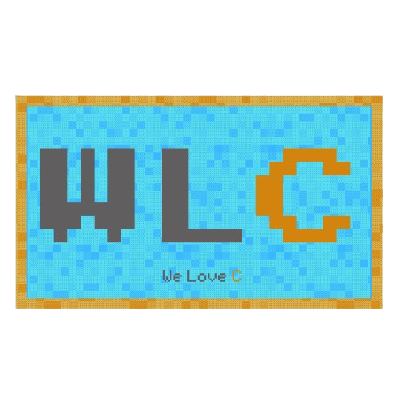
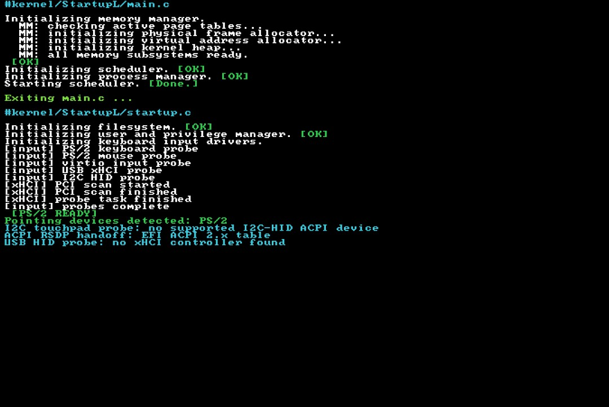
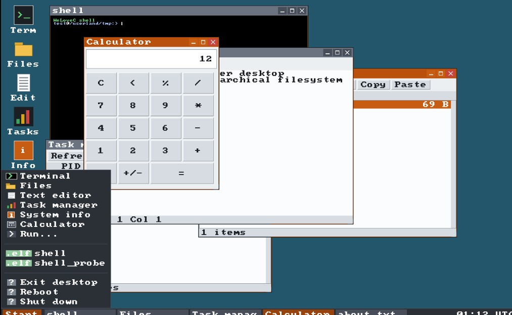
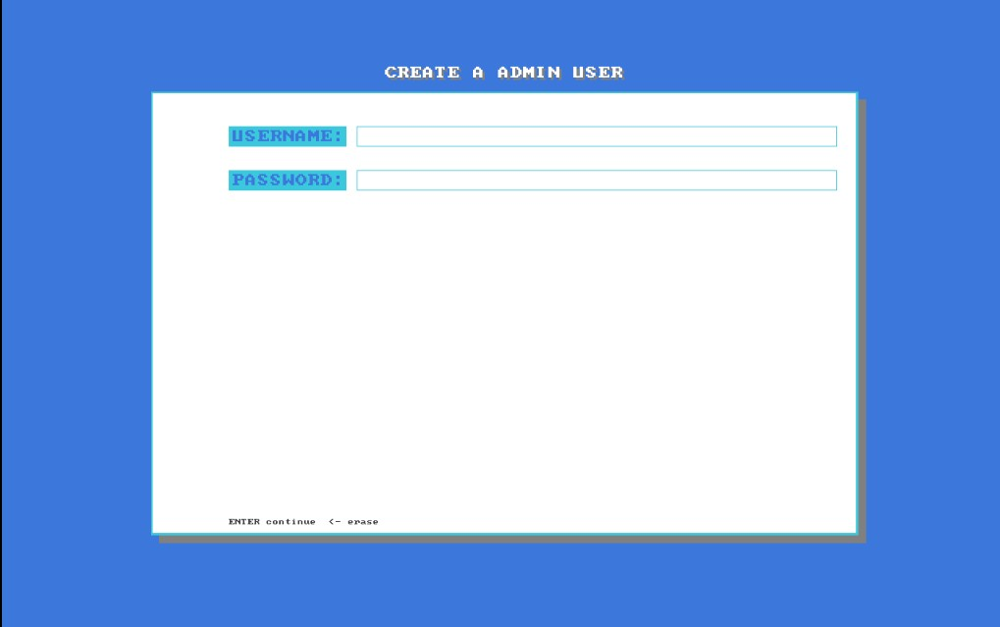

<div align="center">
  
</div>

<p align="center">
  
  
  
 
  
</p>

<p align="center">
  <i>A operating system, built from the ground up.</i>
</p>

---
# WeLoveC Classic

## Overview

**WeLoveC Classic** is an experimental x86_64 operating system developed from scratch, with a focus on low-level programming, modular architecture, memory management, and operating system design.

The project aims to provide a complete and independent operating system environment, including its own UEFI boot manager, kernel, memory subsystem, process management, filesystem layer, security mechanisms, and userland.

Unlike projects built around an existing kernel, WeLoveC Classic is developed with the intention of understanding and implementing the fundamental components that make an operating system work.

Written primarily in C and C++, with Assembly for architecture-specific operations.

## Screenshots

<p align="center">
  
  
  
</p>

## Core Components

| Component | Description |
|---|---|
| UEFI Boot Manager | Custom boot manager with kernel discovery, configuration and an interactive shell. |
| Kernel | Modular x86_64 kernel with architecture-independent and architecture-specific components. |
| Memory Management | Physical memory allocation, virtual memory management, paging and kernel heap. |
| Process Management | Process creation, user threads, address spaces and execution control. |
| ELF64 Loader | Native loading and execution of static x86_64 ELF executables. |
| Scheduler | Kernel scheduling and process execution infrastructure. |
| Filesystem | Virtual filesystem layer and FAT32-based userspace storage. |
| Security | User accounts, authentication, permissions and capability-based access control. |
| Input System | Keyboard and pointing-device support through PS/2, USB HID and virtio-input. |
| Userland | User-space programs, startup management and shell infrastructure. |

## Architecture

WeLoveC Classic follows a modular architecture designed to keep its components independent and maintainable.

The project is organized around four primary directories:

```text
WeLoveC-Classic-OS/
├── bootloader/    # UEFI boot manager
├── kernel/        # Kernel source code
├── userland/      # User-space components
├── third_party/   # External dependencies
├── Makefile       # Main build system
└── README.md
```

The kernel is divided into multiple subsystems, including architecture support, memory management, process management, input handling, security, filesystem services and device infrastructure.

## Building

WeLoveC Classic uses a Makefile-based build system.

### Requirements

The build environment requires the appropriate compiler and build utilities.

Additional dependencies for the complete ISO build include:

- `clang`
- `cmake`
- `tar`
- `sha256sum` (or `shasum`)
- `xorriso`
- `dosfstools`
- `mtools`

### Build commands

Clone the repository:

```bash
git clone https://github.com/saphhic/WeLoveC-Classic-OS.git
cd WeLoveC-Classic-OS
```

Build individual components:

```bash
make kernel
make demo
make userland
```

Generate a bootable UEFI ISO:

```bash
make iso
```

Clean generated build files:

```bash
make clean
```

The resulting ISO is located at:

```text
build/WeLoveC-UEFI.iso
```

## Development Status

WeLoveC Classic is an actively developed project.

The operating system is still evolving, and some components are incomplete, experimental or subject to architectural changes.

The current development focuses on improving kernel stability, expanding hardware support, refining system services and developing the user-space environment.

This is a long-term project, and its architecture will continue to evolve as new subsystems are implemented.

## Documentation

Detailed technical documentation is available in `` 
                                                  /dev_info.
                                                  ``

For more information, explore the [Official Documentation](https://github.com/saphhic/WeLoveC-Classic-OS/blob/main/dev_info/welovec_classic_documentation.md).

Topics include:

- UEFI boot process and kernel handoff.
- Physical and virtual memory management.
- Process and thread architecture.
- ELF64 executable loading.
- Kernel scheduling.
- Filesystem implementation.
- User accounts and security.
- Input and device infrastructure.
- Userland and desktop development.

## Philosophy

WeLoveC Classic is built around a simple idea:

**Build your dream digital space.**

The goal is not simply to make another operating system, but to explore how software interacts with hardware, how kernels manage resources, and how independent system components work together.

Every subsystem is an opportunity to learn, experiment and build something from the ground up.

## Author

**Developed by [@saphhic](https://github.com/saphhic)**

An independent operating system development project since 2024.

GitHub: [github.com/saphhic](https://github.com/saphhic)

## License

WeLoveC Classic is licensed under the **GNU General Public License v2.0 (GPL-2.0)**.

See [LICENSE](LICENSE) for the full license text.

---

<p align="center">
  <sub>WeLoveC Classic OS · Built from scratch with C, C++ and Assembly.</sub>
</p>
